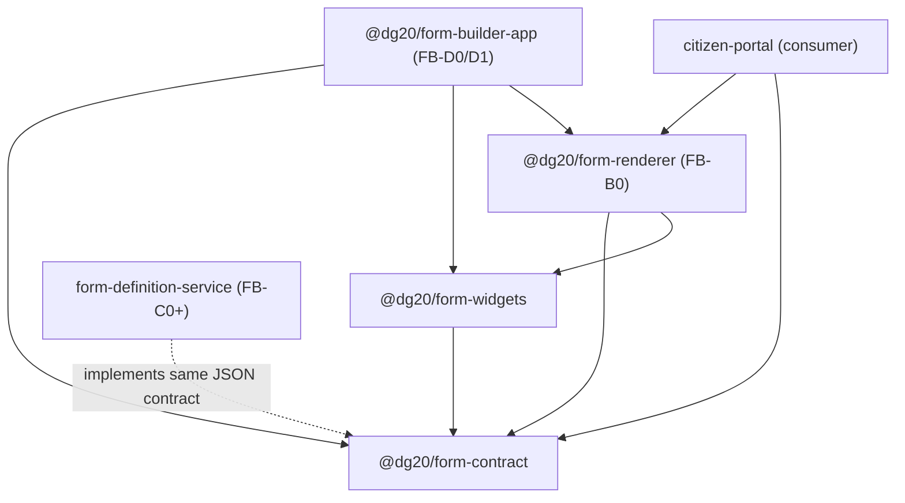

# Form Builder — Architecture (FB-0)

This document describes package boundaries and principles for the DG 2.0 Form
Builder. Implementation details for React widgets, Renderer, Builder SPA, and
the Spring Boot store arrive in later increments.

## Package and deployable boundaries

| Boundary                               | Kind                                 | Responsibility                                                |
| -------------------------------------- | ------------------------------------ | ------------------------------------------------------------- |
| `@dg20/form-contract`                  | npm package                          | Form Definition + validation result types only                |
| `@dg20/form-widgets`                   | npm package                          | Controlled palette metadata + React/RJSF widgets (Unit A)     |
| `@dg20/form-renderer`                  | npm package                          | Single runtime Renderer (Unit B; FB-B0 foundation)            |
| Builder SPA (`@dg20/form-builder-app`) | Vite app under `apps/form-builder/`  | Design-time UI (Unit D); embeds Renderer                      |
| `form-definition-service`              | Spring Boot deployable (`services/`) | JSONB persistence, server validator, publish gate (Units C/E) |

The Spring service is **not** managed by npm workspaces. Frontend packages may
be listed under `packages/*` and future SPAs under `apps/*`. Maven lives under
`services/`.

## Dependency direction

Rules:

- `form-contract` has **zero** dependencies on widgets, React, or Spring.
- Lower layers never import Builder or portal code.
- Portal integration is a **consumer** of the Renderer package, not a reverse
  dependency into Form-builder internals.
- The renderer always uses `dg20Widgets` / `dg20Fields` and an Ajv2020 validator;
  it does not expose custom widget/field/registry/validator extension points.

### Renderer progress (Unit B)

- **FB-B0 / B0.1 / B1 / B1.1 / B2 / B2.1 / B3 / B3.1 / B4 / B4.1 / B5 / B5.1 /
  B6 / B6.1 (done):** package foundation through package-level end-to-end
  acceptance (representative frozen fixture + integrity hotfix). See
  [`renderer.md`](./renderer.md), [`unit-b-acceptance.md`](./unit-b-acceptance.md),
  and [`widget-authoring.md`](./widget-authoring.md).
- **Still pending:** live real-service acceptance (design-spec §5) — requires an
  authoritative published service definition and host/portal/backend wiring.
- **Unit C sequencing exception (2026-07-24):** FB-C0–C5 are authorized while §5
  remains open. See [`unit-c.md`](./unit-c.md).
- **Unit D sequencing exception (2026-07-24):** FB-D0 through FB-D22 are
  authorized while §5, authn/z, DST, and deployment remain open.
  **Package-level Unit D is COMPLETE (FB-D22)** — see
  [`unit-d-acceptance.md`](./unit-d-acceptance.md). Not production-ready.
- **Unit E (FB-E0 audit / FB-E1 foundation / E2–E3 portals / E4 acceptance):**
  E0–E3 technical paths delivered across Form-builder + portals.
  **Package-level Unit E technical acceptance is COMPLETE (FB-E4)** — see
  [`unit-e-acceptance.md`](./unit-e-acceptance.md). Not production-ready; not DST;
  not §5; `governance-technical` remains non-production.
- **FB-E5.1 (Form-builder only):** local FDS multi-stage container image + smoke
  verifier. **No deploy/push; no Helm/portal/IAM/DST.** See
  [`fds-containerization.md`](./fds-containerization.md).
- **FB-E5.5.1 (image supply-chain hardening):** immutable official base
  `tag@sha256` pins (resolved 2026-07-29), Docker Scout SPDX SBOM + CVE gate,
  architecture evidence (host-native FDS image; base indexes support amd64+arm64).
  **No push/deploy/Helm/waiver.** See [`fds-image-supply-chain.md`](./fds-image-supply-chain.md).
- **FB-E5.2 (render-only Helm):** DIGIT-DevOps chart scaffold under
  `core-services/form-definition-service` + Form-builder `npm run e5.2:verify`.
  **No install/upgrade/kubectl/push.** See [`fds-helm-chart.md`](./fds-helm-chart.md).
- **FB-E5.4.1 (officer-governance OIDC foundation):** FDS `governance-oidc`
  OAuth2 Resource Server (RS256, audience `form-definition-service`, actor=`sub`,
  `realm_access.roles` → FDS_* capabilities). Officer adapter forwards Bearer.
  **No live IAM/deploy.** See [`fds-governance-oidc.md`](./fds-governance-oidc.md).
- **FB-E5.4.2A (Builder/operator IAM package foundation):** Builder capability
  authorities on validation/draft/version-list under `governance-oidc`. Builder SPA
  host-owned `accessTokenProvider` (no login/storage). See
  [`fds-governance-oidc.md`](./fds-governance-oidc.md) and
  [`builder-access-token-provider.md`](./builder-access-token-provider.md).
- **FB-E5.4.2B (authenticated Builder clone + submit):** `POST …/builder/drafts/from-version`
  and `POST …/builder/lifecycle-transitions` with JWT `sub` as actor; technical
  identity-bearing clone/lifecycle remain denyAll. Default SPA HTTP adapters use
  `/builder/…` and omit client `createdBy`/`actorId`.
- **FB-E5.4.3A (officer-hosted Builder foundation):** `@dg20/form-builder-app/embed`
  package entry; officer-portal `/form-builder` route injects request-time
  `accessTokenProvider`; Builder-role UX gate only. **No deploy/IAM.**
- **FB-E5.4.3B (officer Builder FDS proxy allowlist):** officer nginx exact
  allowlist for Builder validation/draft/versions/`/builder/…` clone+submit
  alongside existing governance routes; technical/actuator/published remain
  blocked. Offline `e5.3a:verify` updated. **No deploy/IAM.**
- **FB-E5.3A / E5.3A.1 (portal nginx proxy):** officer/citizen same-origin
  least-privilege `/form-definition-service/` proxy via runtime
  `FORM_DEFINITION_SERVICE_UPSTREAM` (citizen: published/latest GET only;
  officer: governance queue/detail/lifecycle only). **No deploy/push/IAM.**
  See [`fds-portal-proxy.md`](./fds-portal-proxy.md).

### Builder SPA progress (Unit D)

- **FB-D0 (done):** visible read-only three-pane shell — searchable palette,
  illustrative canvas/inspector, embedded FormRenderer preview, EN/GU Builder
  locale, disabled Validate/Save/Submit placeholders. No authoring or HTTP.
- **FB-D1 / D1.1 / D1.2 (done):** pure in-memory authoring session
  (`apps/form-builder/src/authoring/`) layered on the D0 shell. Adds a
  controlled add/remove/reorder for exactly **9 of 30** palette widget types
  (`text-short`, `text-long`, `number`, `currency-inr`, `percentage`,
  `gender`, `yesno`, `section-header`, `info-panel`); the remaining **21**
  stay visible in the searchable palette as disabled "pending" entries.
  Reorder is constrained to within a field's own progressive step. Exact
  localized-pair and governed-entry integrity, typed failure containment, and
  remounted live-region announcements are in place. See
  [`unit-d.md`](./unit-d.md).
- **FB-D2 / D2.1 (done):** governed property editors for the same 9 addable
  widgets. UI drafts are separate from `FormDefinition` (preview updates only
  after Apply). D2.1 fixes currency effective-range validation (blank min =
  ₹0), strict JSON-decimal admission, and a genuine `stale_editor_draft`
  baseline contract.
- **FB-D3 (done):** governed Bilingual workspace — side-by-side EN/GU editing
  for field labels/help/errors and progressive-step labels; shared field drafts
  with the Property Inspector; bilingual Apply preserves unsaved constraint
  drafts; completeness meter from visible draft state; tab keyboard a11y.
- **FB-D3.1 / D3.1.1 (done):** cross-editor isolation — error drafts are
  Bilingual-only; Property/Bilingual validation flags independent; dirty
  selectors split (`isPropertyEditorDirty` / `isFieldBilingualEditorDirty` /
  `isFieldAnyDraftDirty`) so Property Apply does not stay enabled for
  unrelated error drafts.
- **FB-D4 (done):** progressive step-boundary authoring — Steps workspace with
  enable / split / move-boundary / merge; Builder integrity requires
  `concat(fieldIds) === ui:order`; merge blocks on unsaved bilingual step
  drafts; preview remounts on structure key (IDs + field assignments) while
  preserving `previewFormData`.
- **FB-D4.1 / D4.1.1 (done):** focus-request `{requestId,stepId}` with session
  `stepFocusRequestSequence` (never resets when pending is cleared); deferred
  Steps-card focus wins over FormRenderer remount; boundary moves restore Steps
  focus; collision-free JSON `progressiveStructureKey`.
- **FB-D5 (done):** generalized addable registry with governed templates and
  Property editors for `email`, `full-name`, `dob`, and `pincode`. Email
  verification and DOB age gates use canonical `x-dg20`; full-name/PIN keep
  baked object schemas. Builder preview uses no real email/transliteration/PIN
  adapters.
- **FB-D5.1 / D5.1.1 (done):** strict citizen-schema / `x-dg20` admission;
  FullNameWidget snapshot sibling emissions; exact full-name/pincode
  `properties`/`required` membership.
- **FB-D6 / D6.1 (done):** explicit Builder Validate → Unit C validation
  endpoint; valid advisory presentation; exact issue-array admission; UTF-8
  response byte limits; semantic definition cancellation.
- **FB-D7 / D7.1 / D7.1.1 (done):** draft create, exact load, optimistic PUT,
  opaque in-memory ETag, clone-first request/response admission,
  operation-specific failure UX, validation-match Save gate. Lifecycle Submit,
  auth, and DST remain deferred.
- **FB-D8 (accepted):** governed `aadhaar`, `mobile-otp`, and `bank-account`
  templates/editors (`ui:field`); strict schema admission; OTP contract aligned
  to lowercase `["sms"]` on client runtime and Unit C StructuralSanityValidator.
  Counts at D8: **16 addable / 14 pending / 30 total**.
- **FB-D9 (accepted):** configured-add foundation for `dropdown-master` and
  `radio` (`ui:widget`); exact required `x-dg20.masterListId`; no Builder
  master-data HTTP. Counts at D9: **18 addable / 12 pending / 30 total**.
- **FB-D9.1 (accepted):** configured-add keyboard focus sequencing, modal
  containment (`inert` + Tab trap), and pending-draft isolation on second begin.
- **FB-D10 (done):** governed `multiselect` (`ui:widget`) and
  `cascading-dropdown` (`ui:field`); discriminated configured-add drafts;
  optional multiselect bounds; cascading parent/child list IDs (may be equal);
  strict schema admission; Unit C required-list and bounds rules. List
  existence remains an external master-data dependency — no Builder HTTP or
  option management. Counts at D10: **20 addable / 10 pending / 30 total**.
- **FB-D10.1 (accepted):** required multiselect must serialize explicit
  `minItems >= 1` (JSON Schema / Builder / Unit C / AJV aligned; no virtual
  client-only minimum).
- **FB-D11 (accepted):** governed `address-block` and `photo-capture`
  (`ui:field`); address geography codes only with optional `defaultStateCode`;
  photo CLEAN object-store reference only with locked Unit A policy constants
  (provisional); no Builder GeographyAdapter / FileStorageAdapter HTTP. Counts
  at D11: **22 addable / 8 pending / 30 total**.
- **FB-D12 (accepted):** configured-add for `doc-upload` and `digilocker-fetch`
  (`ui:field`); MIME one-per-line + max bytes ≤
  `DOCUMENT_UPLOAD_GLOBAL_MAX_BYTES`; DigiLocker exact type code; schema/`x-dg20`
  synchronized; object-store / malware scanning / DigiLocker provider remain
  external — no production integration claim. Counts at D12:
  **24 addable / 6 pending / 30 total**.
- **FB-D13 (done):** configured-add for `fee-field` (`ui:field`) with exact
  `feeRuleId` (schema `const` + `x-dg20`); immediate-add for `signature-esign`
  (`ui:field`, no `x-dg20`); fee/eSign runtime contexts and providers remain
  external; eSign contract provisional — no production fee/eSign claim.
  Counts at D13: **26 addable / 4 pending / 30 total**.
- **FB-D14 (done):** configured-add for `eligibility-declaration` (`ui:field`)
  with exact `declarationId` (schema `const` + `x-dg20`); Confirm seeds
  mandatory bilingual declaration help; `ConsentLoggingAdapter` remains
  external — no fabricated receipts or production consent claim. Counts at D14:
  **27 addable / 3 pending / 30 total**.
- **FB-D15 (done):** configured-add for `caf-prefill` (`ui:field`) with exact
  `cafAttribute` + strict `confidenceMin` (0–1); Confirm creates one
  `PrefillBinding` in `meta.prefillBindings`; Bindings workspace authoring with
  draft isolation; CAF adapters remain external — no invented Golden Record
  values. Counts: **28 addable / 2 pending / 30 total**.
- **FB-D16 (done):** governed Family Repeater authoring with Builder-only
  `FAMILY_MEMBER` nested palette; Unit C repeater strengthenings (no DB
  migration). Counts at D16: **29 addable / 1 pending / 30 total**.
- **FB-D17 (done):** `page-break` is a structural progressive-step boundary
  action (not a field template). Create-boundary dialog mutates only
  `meta.progressiveSteps`; legacy literal `ui:field: "page-break"` remains
  readable without auto-conversion. Counts: **30 addable / 0 pending / 30 total**
  (29 field templates + 1 structural).
- **FB-D18 (done):** technical draft → submitted lifecycle wiring with
  host-provided actor; submitted definitions are read-only.
- **FB-D19 (done):** version history listing + clone-to-new-draft from
  published|retired.
- **FB-D20 (done):** accessible within-step canvas reorder (native HTML5 drag +
  keyboard mode; Move Up/Down remain the 390px fallback). No new drag library.
- **FB-D21 (done):** governed Integration Hub + Workflow binding authoring in the
  Bindings tab (`collectBindableFields`, draft isolation, opaque adapter/stage IDs).
- **FB-D22 (done):** package-level Unit D acceptance harness — frozen representative
  fixture, in-memory acceptance adapters, consolidated shell/browser journeys,
  and documented matrix in [`unit-d-acceptance.md`](./unit-d-acceptance.md).
  **Package-level Unit D: COMPLETE.**
- **FB-E1 (done):** Form Definition Service governance foundation — fail-closed
  `GovernancePrincipalProvider`, capability authorization, submitted/approved
  queue + detail, secured approve/publish (server-derived actor). Technical
  lifecycle endpoint unchanged. Queue is status-derived, **not** DST. See
  [`unit-e.md`](./unit-e.md).
- **Deferred / external:** E2 officer portal UI, E3 citizen renderer integration,
  real JWT/Keycloak, DST contract, cross-step drag, retirement UI, deployment,
  §5 live-service acceptance, governance of provisional policies.

### Form Definition Service progress (Unit C)

- **FB-C0 / C0.1 (done):** JSONB persistence + create-only insert + strict coordinates.
- **FB-C1 (done):** pure five-stage `FormDefinitionValidationPipeline`.
- **FB-C2 (done):** validate + draft create + exact read REST.
- **FB-C3 (done):** draft PUT + opaque ETag / If-Match optimistic locking.
- **FB-C4 (done):** technical lifecycle transitions + append-only event log (Flyway V2)
  - immutable new-draft version allocation. `actorId` is a provisional
    unauthenticated assertion — not DST/authz completion.
- **FB-C4.1 (done):** create, clone allocation, and lifecycle transitions share one
  PostgreSQL service-level transaction advisory lock
  (`pg_advisory_xact_lock(hashtextextended(serviceId, 0))`) acquired before the
  first source/definition load. Draft PUT remains `@Version`-only.
- **FB-C5 (done):** citizen-facing `GET .../published/latest` release-head
  lookup (backed by a Flyway V3 partial index; policy is technical, pending
  final governance confirmation) and `GET .../versions` bounded ascending
  version listing (`limit`/`afterVersion` cursor, no `COUNT(*)`). Consolidated
  package-level acceptance suite (`FormDefinitionUnitCAcceptanceIT`) covers all
  fifteen FB-C5 acceptance points against an illustrative fixture. See
  [`unit-c-acceptance.md`](./unit-c-acceptance.md).
- **Deferred (post-C5):** authn/z, DST governance workflow integration,
  deployment, design-spec §5 live real-service acceptance.

## Principles

### Render once

There is exactly one rendering path. The Builder live-preview embeds the same
Renderer citizens use. What a department designs must be byte-identical to what
a citizen sees for a given published Form Definition version.

### Controlled palette

Departments compose only from the approved palette registry. Widget IDs are
stable machine identifiers. The registry is not runtime-extensible by department
users. No `custom-field` or `raw-json` widget exists or will be added without a
governed engineering change.

### Client / server validation

`jsonSchema` (JSON Schema Draft 2020-12) is the single data-shape validation
source. The browser (RJSF / Ajv2020) and the server (`FormDefinitionValidationPipeline`
Stage 1) both apply Draft 2020-12. Stages 2–5 add palette provenance, bilingual
completeness, binding integrity, and structural / `x-dg20` checks (spec §6).
C1 delivers the pure pipeline; C2 wires it before external draft create.

### Bilingual content ownership

- **Form field strings** (labels, help, errors) live in
  `FormDefinition.meta.bilingual` (EN + GU per field).
- **Builder chrome / palette catalogue labels** may use package metadata
  (`labelEn` / `labelGu` on palette entries) or future i18n resources.
- Do not hard-code citizen-visible field copy in React components.

### Published definitions are immutable

Once `status` is `published`, that `(serviceId, version)` row must not change.
Edits create a new draft version. In-flight applications retain their start
version.

## Planned Spring Boot / PostgreSQL boundary

- Database: PostgreSQL 16, shared `egov_db`, schema `form_definition`
  (**FB-C0 implemented** under `services/form-definition-service/`).
- Storage: Form Definition document as **JSONB**, keyed by `(serviceId, version)`.
- API: Spring Boot 3.3.x Magicsword-aligned service (context path, actuator
  probes). FB-C2–C5 expose validate, draft CRUD-ish, lifecycle transitions,
  new-draft cloning, published-latest lookup, and version listing under
  `/form-definition-service/api/v1/...`. Create/clone/lifecycle share a
  service-level TX advisory lock. Authn/z remain deferred beyond C5.
- See [`unit-c.md`](./unit-c.md).

## Workflow bindings are engine-agnostic

`workflowBindings[].stage` is an opaque string. Form Builder does **not** embed
Camunda, Flowable, or bpmn-js. The demo platform today uses Flowable; the bid
target may use Camunda 8. Bindings remain portable stage identifiers resolved
by the hosting workflow system.

## External integrations are adapters

DigiLocker, eSign, Notification OTP, fee engine, master-data lists, CAF / Golden
Record pre-fill, and DST approval queue are **bound** via Form Definition meta
and widget hooks. Adapter implementations live in Integration Hub / other
workstreams — **not** inside Form-builder foundation packages. FB-0 defines
types and palette metadata only; adapters are stubs or future wiring.
